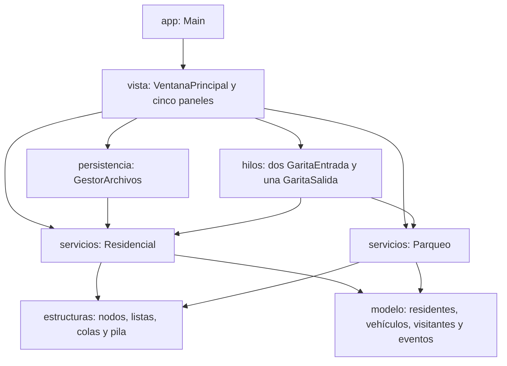
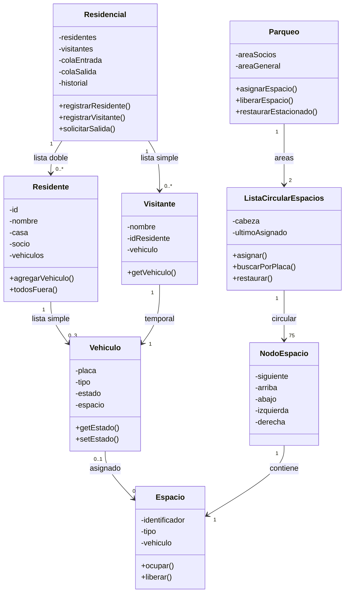

# RESIPARK

**Control de accesos y estacionamiento**

## Manual técnico

**Arquitectura, estructuras, concurrencia y persistencia**

| Dato     | Información                                                   |
| -------- | ------------------------------------------------------------- |
| Curso    | Laboratorio de Introducción a la Programación y Computación 1 |
| Sección  | IPC1F                                                         |
| Periodo  | Segundo semestre de 2026                                      |
| Autor    | Keneth David Echeverria González                              |
| Proyecto | Proyecto 2 — ResiPark                                         |

---

## 1. Objetivo y alcance

ResiPark administra el registro de residentes y sus vehículos, la recepción de visitantes y el flujo de entrada y salida de un estacionamiento residencial. La aplicación permite observar, mediante una interfaz Java Swing, la ocupación de **150 espacios**, las colas de acceso, el estado de las garitas y el historial de eventos.

El parqueo está dividido en dos zonas. El área de **socios** comprende las filas A, B y C, con 25 posiciones por fila. El área **general** comprende las filas E, F, G, H e I, con 15 posiciones por fila. No existe la fila D y cada espacio admite un solo vehículo.

La simulación contempla residentes socios, residentes no socios y visitantes. Se aplican restricciones de acceso por área, controles de duplicidad y validaciones de los estados de cada vehículo.

## 2. Tecnologías y ejecución

- **Lenguaje:** Java, con compilación compatible con JDK 17.
- **Interfaz:** Java Swing, construida manualmente sin diseñador visual.
- **Concurrencia:** tres hilos de garitas y sincronización mediante mecanismos nativos de Java.
- **Estructuras:** listas, colas y pila enlazadas con nodos propios, sin sustituirlas por colecciones de `java.util`.
- **Persistencia:** lectura y escritura de archivos de texto UTF-8.
- **Control de versiones:** Git y GitHub.
- **Clase de entrada:** `app.Main`.

El sistema se distribuye mediante `ResiPark.jar` y requiere Java 17 o una versión superior para ejecutarse.

## 3. Arquitectura y paquetes

Separé la aplicación en paquetes para mantener independientes la interfaz gráfica, el modelo de datos, las estructuras, las reglas del sistema, la ejecución de los hilos y el almacenamiento en archivos.

*Figura 1. Dependencias principales entre los paquetes.*

| Paquete        | Contenido / responsabilidad                                                                                       |
| -------------- | ----------------------------------------------------------------------------------------------------------------- |
| `app`          | `Main` inicia la ventana en el hilo de eventos de Swing.                                                          |
| `vista`        | `VentanaPrincipal`, `PanelParqueo`, `PanelResidentes`, `PanelEntrada`, `PanelSalida` y `PanelEventos`.            |
| `modelo`       | `Residente`, `Vehiculo`, `Visitante`, `Espacio`, `Evento`, `TipoUsuario` y `ReglaNegocioException`.               |
| `estructuras`  | `Nodo`, `NodoEspacio`, `ListaSimple`, `ListaDoble`, `ListaCircularEspacios`, `Cola` y `Pila`.                     |
| `servicios`    | `Residencial` aplica reglas de registro y controla colas y eventos; `Parqueo` administra espacios y asignaciones. |
| `hilos`        | `Garita`, `GaritaEntrada` y `GaritaSalida` ejecutan la atención concurrente.                                      |
| `persistencia` | `GestorArchivos` guarda y recupera la información en archivos TXT.                                                |

## 4. Diagrama de clases y relaciones

*Figura 2. Relación resumida entre las entidades y estructuras principales.*

Cada residente mantiene una lista simple de hasta tres vehículos. Cada visitante está asociado a un vehículo temporal. Un espacio ocupado conserva una referencia al vehículo asignado, y el vehículo conserva la referencia al espacio. Cuando la garita procesa una salida, ambas referencias se liberan.

La clase `Residencial` administra la lista doble de residentes, una lista simple de visitantes activos, dos colas FIFO y una pila LIFO para los eventos.

## 5. Estructuras de datos implementadas

| Estructura               | Uso y comportamiento                                                                                                       |
| ------------------------ | -------------------------------------------------------------------------------------------------------------------------- |
| `ListaDoble<Residente>`  | Almacena residentes con enlaces `siguiente` y `anterior`; admite altas, bajas, búsquedas y recorrido en ambos sentidos.    |
| `ListaSimple<Vehiculo>`  | Mantiene los vehículos de cada residente, con un máximo de tres.                                                           |
| `ListaSimple<Visitante>` | Conserva temporalmente los visitantes activos mientras están en cola o dentro del residencial.                             |
| `ListaCircularEspacios`  | Representa cada área mediante 75 nodos circulares; recuerda el último espacio asignado para continuar el recorrido.        |
| `NodoEspacio`            | Guarda el espacio y el enlace `siguiente`; adicionalmente contiene referencias `arriba`, `abajo`, `izquierda` y `derecha`. |
| `Cola<Vehiculo>`         | Implementa dos colas FIFO: una entrada compartida por dos garitas y una salida atendida por una garita.                    |
| `Pila<Evento>`           | Guarda eventos mediante una pila LIFO; el más reciente aparece primero.                                                    |

La representación principal del parqueo son las dos **listas circulares simplemente enlazadas**. Los enlaces adicionales de `NodoEspacio` representan relaciones de vecindad en la distribución física, sin sustituir el recorrido circular.

## 6. Distribución y asignación de espacios

| Área    | Filas         | Cantidad    | Usuarios permitidos                                                 |
| ------- | ------------- | -----------:| ------------------------------------------------------------------- |
| Socios  | A, B, C       | 3 × 25 = 75 | Residentes socios.                                                  |
| General | E, F, G, H, I | 5 × 15 = 75 | No socios, visitantes y socios cuando el área exclusiva está llena. |

El procedimiento de asignación empieza en el nodo siguiente al último espacio asignado. Recorre la lista circular hasta encontrar una posición válida o completar una vuelta.

Para un vehículo de socio, el sistema intenta primero el área reservada y, si está llena, busca en el área general. Para un vehículo de no socio o visitante se consulta únicamente el área general.

El recorrido no regresa siempre al primer espacio. Por ejemplo, si el último asignado fue A15, se continúa desde A16; al llegar al final de la lista se vuelve a A1. Así se reutilizan las posiciones libres sin asignar un mismo espacio a dos vehículos.

Un vehículo que ya está estacionado no cambia automáticamente de área aunque posteriormente se liberen posiciones reservadas para socios.

## 7. Estados y flujo de vehículos

| Estado            | Interpretación                                                                     |
| ----------------- | ---------------------------------------------------------------------------------- |
| `FUERA`           | El vehículo no está estacionado ni tiene una solicitud activa de ingreso o salida. |
| `EN_COLA_ENTRADA` | Espera o está siendo atendido por una garita de entrada.                           |
| `ESTACIONADO`     | Tiene un espacio asignado.                                                         |
| `EN_COLA_SALIDA`  | Solicitó salir y conserva ocupado su espacio hasta finalizar la atención.          |

El flujo general es el siguiente:

1. El usuario registra o selecciona un vehículo en estado `FUERA` y solicita su entrada.
2. `Residencial` lo agrega a la cola FIFO de entrada y registra el evento.
3. Una de las dos garitas retira el vehículo y simula una atención de entre 1 y 3 segundos.
4. `Parqueo` busca un espacio válido y registra la asignación; si no existe, el vehículo vuelve a `FUERA`.
5. Para salir, el vehículo debe estar `ESTACIONADO`. La solicitud cambia su estado a `EN_COLA_SALIDA`, pero todavía no libera la posición.
6. La garita de salida procesa la solicitud, libera el espacio y cambia el estado a `FUERA`.
7. Si el vehículo pertenece a un visitante, su registro temporal se elimina después de la salida o del rechazo.

## 8. Hilos y sincronización

`Garita` implementa `Runnable`. Se crean dos objetos `GaritaEntrada` que consumen una misma `Cola<Vehiculo>` de entrada y un objeto `GaritaSalida` que consume la cola de salida.

El método `desencolar()` espera dentro de un ciclo `while` cuando no hay vehículos. `encolar()` utiliza `notifyAll()` para despertar los hilos que esperan en la cola. Las operaciones de las estructuras compartidas emplean `synchronized` para impedir modificaciones simultáneas inconsistentes.

La atención se simula con `Thread.sleep` durante un tiempo aleatorio de 1000 a 3000 milisegundos. Los cambios de la interfaz se ejecutan mediante `SwingUtilities.invokeLater` para respetar el hilo de eventos de Swing.

Al cerrar la ventana, se detienen las garitas de manera ordenada, se espera su finalización y se ejecuta el guardado de archivos. El procesamiento concurrente utiliza una sola cola de entrada: cualquiera de las dos garitas disponibles puede tomar el siguiente vehículo. No se impone un turno alternado.

## 9. Persistencia y formato de los archivos

La información se guarda en archivos de texto ubicados en el directorio de trabajo de la aplicación. Los formatos obligatorios de residentes y vehículos se mantienen sin columnas adicionales.

| Archivo          | Formato                                     | Ejemplo                                |
| ---------------- | ------------------------------------------- | -------------------------------------- |
| `residentes.txt` | `ID\|NOMBRE\|CASA\|SOCIO`                   | `701\|Ana Morales\|A-12\|S`            |
| `vehiculos.txt`  | `PLACA\|MARCA\|MODELO\|COLOR\|ID_RESIDENTE` | `SOC001\|Toyota\|Corolla\|Blanco\|701` |
| `ocupacion.txt`  | `PLACA\|ESTACIONADO\|ESPACIO`               | `SOC001\|ESTACIONADO\|A1`              |

`ocupacion.txt` es un archivo complementario que permite recuperar el estado `ESTACIONADO` y el espacio exacto de los vehículos registrados. Se agregó para atender la aclaración del auxiliar sin alterar los dos formatos obligatorios del enunciado.

Durante el inicio se recuperan primero los residentes, después sus vehículos y finalmente las posiciones ocupadas. Las referencias se reconstruyen solamente cuando existen el vehículo y el espacio correspondiente y la asignación respeta las restricciones del área.

Consideraciones:

- `SOCIO` se almacena como `S` o `N`.
- El carácter `|` no puede aparecer dentro de los campos registrados.
- Los archivos se buscan en el **directorio de trabajo**, que puede ser distinto de la carpeta física del JAR si se ejecuta desde otra ubicación.
- Si falta un archivo, el programa puede comenzar con los datos disponibles; los archivos se crean al guardar durante el cierre.
- Las líneas inválidas se omiten y generan un evento `LINEA_OMITIDA`.
- Los visitantes y el historial de eventos son temporales y no se almacenan en los TXT.
- `vehiculos.txt` no incluye el tipo de vehículo; al recuperar un registro se utiliza `AUTOMOVIL` por defecto.
- La recuperación de ocupación se aplica a vehículos registrados; los visitantes no se restauran.

## 10. Reglas de negocio

- El ID de cada residente es único y no se modifica después del registro.
- Cada residente puede registrar como máximo tres vehículos.
- Las placas deben ser únicas entre los vehículos registrados y los visitantes activos.
- No se puede eliminar un vehículo que esté en cola o estacionado.
- No se puede eliminar un residente ni cambiar su condición de socio si tiene vehículos que no están `FUERA`.
- No se puede enviar dos veces a Entrada un vehículo que ya esté en cola o estacionado.
- Solamente los vehículos `ESTACIONADO` pueden solicitar salida.
- Los residentes no socios y los visitantes no pueden usar el área reservada para socios.
- Los visitantes deben indicar un residente existente y se eliminan de la memoria al salir o ser rechazados.
- La aplicación separa las validaciones de usuarios y vehículos (`Residencial`) de las operaciones de ocupación (`Parqueo`).

---

**ResiPark — Manual técnico | LAB IPC1F — Segundo semestre de 2026**
