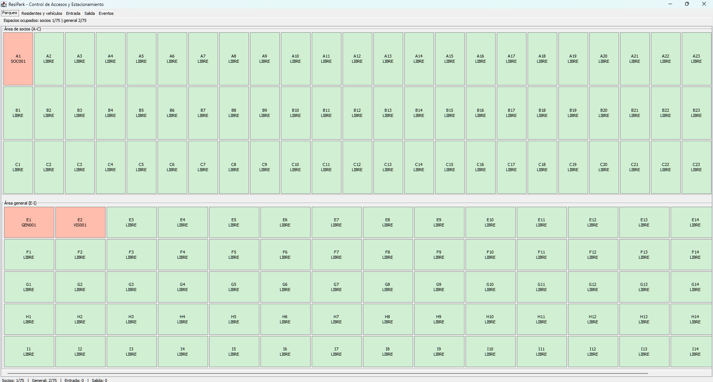
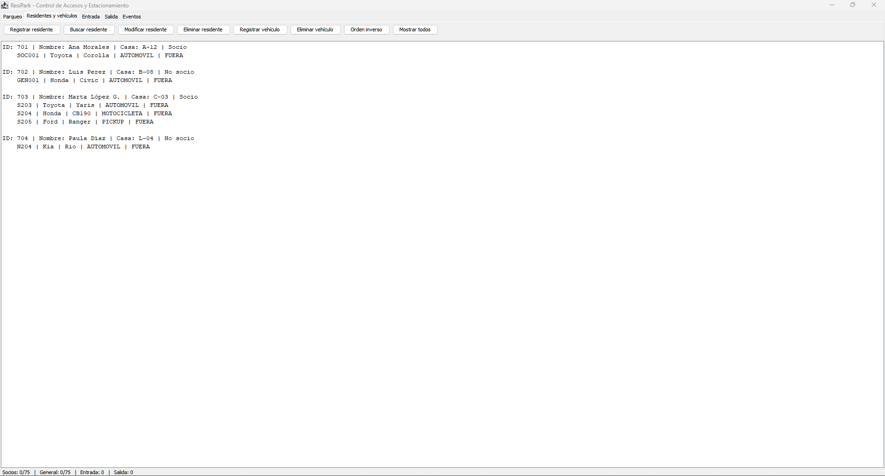
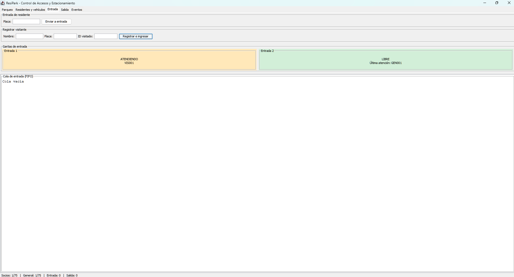
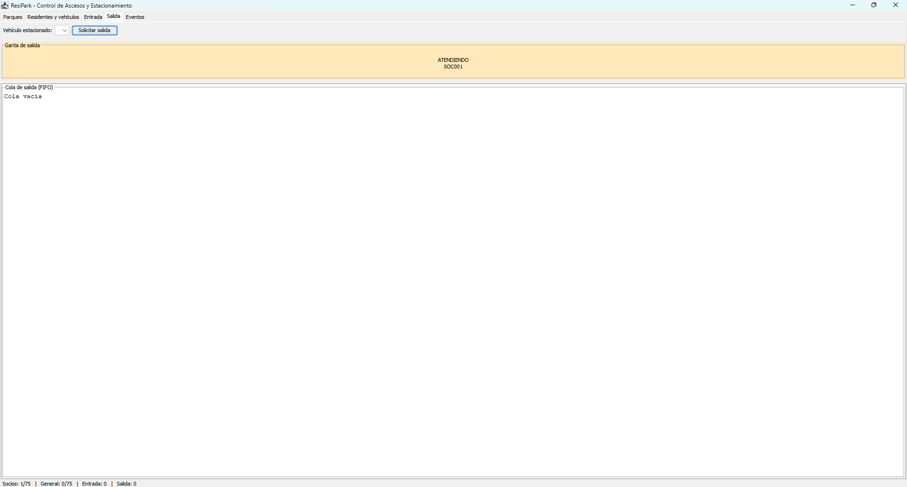
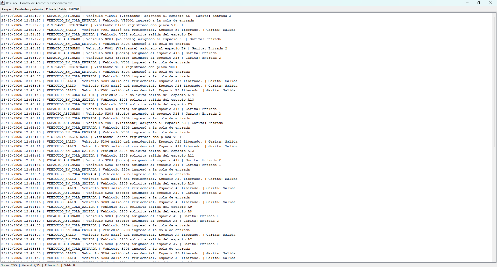

# RESIPARK

**Control de accesos y estacionamiento**

## Manual de usuario

**Uso de los cinco paneles de ResiPark**

| Dato     | Información                                                   |
| -------- | ------------------------------------------------------------- |
| Curso    | Laboratorio de Introducción a la Programación y Computación 1 |
| Sección  | F                                                             |
| Periodo  | Segundo semestre de 2026                                      |
| Autor    | Keneth David Echeverria González                              |
| Proyecto | Proyecto 2 — ResiPark                                         |

---

## 1. Requisitos para ejecutar

- Tener instalado **Java 17 o superior**.
- Disponer del archivo ejecutable `ResiPark.jar`.
- Mantener `residentes.txt` y `vehiculos.txt` en la carpeta desde la que se ejecutará el programa.
- Mantener `ocupacion.txt` en la misma carpeta cuando se desee recuperar la ubicación de los vehículos estacionados.
- No se requieren bases de datos ni conexiones con servicios externos.

## 2. Iniciar la aplicación

1. Abrir la carpeta que contiene `ResiPark.jar` y los archivos de datos.

2. Hacer doble clic en `ResiPark.jar` si Windows tiene configurada la apertura de archivos JAR mediante Java.

3. Si el archivo no se abre, escribir `cmd` en la barra de direcciones del Explorador de archivos y presionar **Enter**.

4. Ejecutar el siguiente comando en la ventana de comandos:
   
   ```bat
   java -jar ResiPark.jar
   ```

5. Esperar a que aparezca la ventana **ResiPark - Control de Accesos y Estacionamiento**.

6. Verificar que estén disponibles las pestañas **Parqueo**, **Residentes y vehículos**, **Entrada**, **Salida** y **Eventos**.

Los archivos de datos se leen y guardan en el directorio de trabajo. Por ello, es importante iniciar la aplicación desde la misma carpeta que contiene el JAR y los archivos TXT.

## 3. Panel Parqueo

El panel muestra los **150 espacios** del estacionamiento, distribuidos en dos áreas:

- **Área de socios:** filas A, B y C, con 25 espacios por fila.
- **Área general:** filas E, F, G, H e I, con 15 espacios por fila.

Los espacios libres aparecen en verde claro y los ocupados en tono rojizo, identificados con la placa del vehículo. En la parte superior se muestran los contadores de ocupación y, en la parte inferior de la ventana, el resumen de las colas de entrada y salida.

La ocupación se actualiza automáticamente cuando una garita termina de procesar el ingreso o la salida de un vehículo. Cada espacio admite un solo vehículo.



*Figura 1. Distribución de los espacios en el área de socios y el área general.*

## 4. Panel Residentes y vehículos

Este panel permite administrar los residentes y los vehículos asociados a cada uno.

1. Seleccionar **Registrar residente** e ingresar el ID, nombre, casa o lote y la condición de socio.
2. Para agregar un vehículo, seleccionar **Registrar vehículo** e ingresar el ID del residente, placa, marca, modelo, color y tipo de vehículo.
3. Utilizar **Buscar residente** para consultar su información y los vehículos registrados.
4. Seleccionar **Modificar residente** para actualizar el nombre, casa o condición de socio.
5. Utilizar **Eliminar vehículo** o **Eliminar residente** cuando sus vehículos no estén estacionados ni en las colas.
6. Seleccionar **Orden inverso** para mostrar los residentes desde el último registrado hasta el primero.
7. Seleccionar **Mostrar todos** para quitar los filtros y visualizar el listado completo en su orden original.

Cada residente puede registrar un máximo de **tres vehículos**. Las placas deben ser únicas en el sistema y el ID del residente no puede modificarse después del registro. No se permite cambiar la condición de socio ni eliminar a un residente mientras tenga vehículos en uso.



*Figura 2. Administración de residentes y consulta de vehículos registrados.*

## 5. Panel Entrada

En esta pestaña se solicitan ingresos de vehículos registrados y se reciben visitantes.

1. Para ingresar un vehículo registrado, escribir su placa y pulsar **Enviar a entrada**.
2. Para ingresar un visitante, completar los campos **Nombre**, **Placa** e **ID visitado** y seleccionar **Registrar e ingresar**.
3. Observar la **cola de entrada FIFO** y las garitas **Entrada 1** y **Entrada 2**.
4. Esperar a que una garita complete la atención, cuyo tiempo varía aproximadamente entre **1 y 3 segundos**.
5. Consultar **Parqueo** para confirmar el espacio asignado o **Eventos** para comprobar si la entrada fue rechazada.

Los socios utilizan primero los espacios reservados de las filas A–C. Si esa área está llena, pueden ocupar un espacio general. Los no socios y los visitantes únicamente pueden ingresar al área general.

Cada garita muestra el estado **ATENDIENDO** o **LIBRE** y conserva la placa del último vehículo atendido. La cola muestra los vehículos pendientes de atención; cuando una garita retira un vehículo, este deja de aparecer en la cola aunque su atención continúe.



*Figura 3. Registro de entradas y funcionamiento de las dos garitas.*

## 6. Panel Salida

El panel permite solicitar la salida de vehículos que se encuentran estacionados.

1. Seleccionar la placa en la lista **Vehículo estacionado**.
2. Pulsar **Solicitar salida**.
3. Observar la **cola de salida FIFO** y el estado de la garita.
4. Esperar a que la garita complete la atención y libere el espacio asignado.

El vehículo conserva su espacio mientras espera la salida. Una vez que termina la atención, cambia al estado `FUERA` y el espacio vuelve a estar disponible.

El recuadro de la garita indica **ATENDIENDO** o **LIBRE** y mantiene visible la última placa atendida. Si el vehículo pertenece a un visitante, su registro temporal se elimina al finalizar la salida.



*Figura 4. Solicitud de salida y atención de la garita con su cola FIFO.*

## 7. Panel Eventos

Este panel permite consultar los acontecimientos registrados durante la ejecución: altas y modificaciones de residentes, registros de vehículos y visitantes, solicitudes de entrada y salida, asignaciones, rechazos y liberaciones de espacios.

Los eventos se almacenan en una **pila LIFO**, de manera que los más recientes aparecen primero. Cada registro identifica el acontecimiento, su fecha y hora, y la garita correspondiente cuando aplica.

El historial pertenece a la sesión actual y no se guarda al cerrar el programa.



*Figura 5. Historial de operaciones presentado del evento más reciente al más antiguo.*

## 8. Guardado y recuperación

1. Cerrar la aplicación mediante el botón de cierre de la ventana.
2. Esperar a que finalice el proceso de atención y guardado.
3. Verificar los archivos `residentes.txt`, `vehiculos.txt` y `ocupacion.txt` en la carpeta de ejecución.
4. Volver a ejecutar `ResiPark.jar` desde esa misma carpeta.
5. Comprobar que se recuperan los residentes, los vehículos registrados y la ubicación de los vehículos estacionados.

El archivo `ocupacion.txt` permite reconstruir el estado `ESTACIONADO` y el espacio correspondiente a cada vehículo registrado. Los vehículos sin una ocupación guardada comienzan en estado `FUERA`. Los visitantes temporales, las colas y el historial de eventos no se recuperan entre sesiones.

El formato de `vehiculos.txt` no almacena el tipo de vehículo, por lo que al recuperar los registros se utiliza `AUTOMOVIL` de forma predeterminada.

## 9. Mensajes de validación frecuentes

| Situación                                          | Comportamiento esperado                                           |
| -------------------------------------------------- | ----------------------------------------------------------------- |
| ID de residente repetido                           | Se informa que ya existe un residente con ese ID.                 |
| Placa repetida                                     | Se informa que ya existe un vehículo con esa placa.               |
| Cuarto vehículo del mismo residente                | Se rechaza el registro.                                           |
| Residente inexistente                              | Se rechaza la operación que requiere un residente válido.         |
| Campos vacíos o con el carácter `\|`               | Se rechaza la operación y se muestra un mensaje de validación.    |
| Entrada de vehículo que no está `FUERA`            | Se informa que el vehículo ya está dentro o en cola.              |
| Solicitud de salida sin vehículo estacionado       | No se dispone de una placa válida para solicitar la salida.       |
| Eliminar un vehículo estacionado o en cola         | La eliminación se rechaza.                                        |
| Eliminar un residente con vehículos en uso         | La eliminación se rechaza.                                        |
| Cambiar la condición de socio con vehículos en uso | El cambio se rechaza.                                             |
| Área permitida llena                               | Se rechaza la entrada y se registra el acontecimiento en Eventos. |

---

**ResiPark — Manual de usuario | LAB IPC1F — Segundo semestre de 2026**
